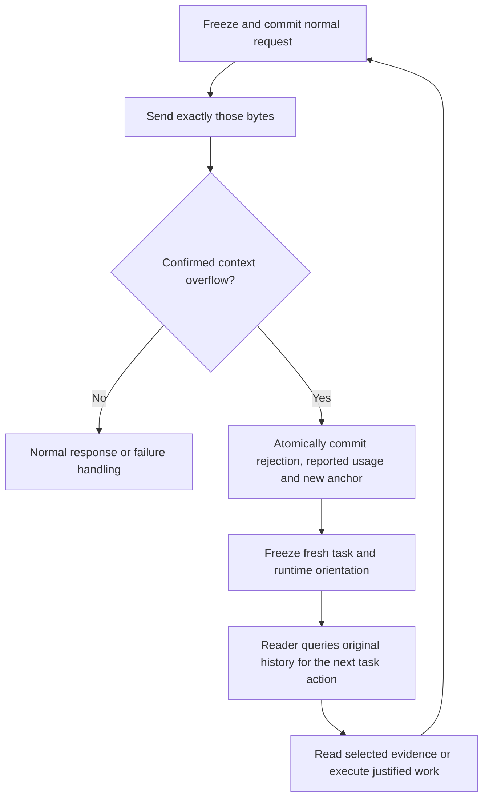

# Provider-driven, reader-controlled context recovery

Research date: 2026-11-08. This document separates observed implementation facts
from implications for canti. It records source inspection and offline probes,
not live provider or recovery validation.

## Finding

The recommended direction is a committed context boundary followed by
reader-controlled access to historical evidence. An anchor need not contain
a summary, and opening a new context need not depend on the predecessor
producing anything. This structurally removes the circular dependency in
"the context is already too large, so ask that context to summarize itself".

Use provider-reported usage exclusively and initiate automatic context resets
only on a confirmed context-limit signal. Canti already avoids token
estimation; its current handover policy is proactive **byte-capacity**
management. The meaningful refactor separates durable history, the active
context boundary, and the evidence the next request selects.

The supported claim is that summary generation should not be mandatory for
continuity; this does not prohibit optional task notes. The user has now
chosen to build the reader-driven design and verify it by using canti itself.
Comparative evaluation is not a delivery gate. Some providers return ambiguous
generation-limit signals; the strict overflow-confirmation limitation below
remains unchanged.

This report replaces its earlier mandatory-summary recovery proposal with
an anchor-and-pull design. The concrete contracts and build-then-dogfood
acceptance are in the [implementation plan](provider-context-recovery-plan.md).

Baseline: canti `a7e40fa244dae1d4ded178dabb559749f2659aeb`, context version 16,
core semantics 5, SQLite schema 3, host RPC protocol 5. Local source links
refer to this checkout. Bub and Republic references are pinned below.

## Bub: what the reference actually implements

The reference is Bub commit
[`7b95690550544e95588d19920864fbcb71826d59`](https://github.com/bubbuild/bub/tree/7b95690550544e95588d19920864fbcb71826d59).
Its lockfile selects Republic 0.6.0; that release tag resolves to
[`fdaddc5a42eafb6cf913dc9d2283d6fc60bf78a3`](https://github.com/bubbuild/republic/tree/fdaddc5a42eafb6cf913dc9d2283d6fc60bf78a3).
The provider-layer findings below apply to that dependency, not an unspecified
Republic release. [Bub lockfile](https://github.com/bubbuild/bub/blob/7b95690550544e95588d19920864fbcb71826d59/uv.lock#L2036-L2048)

### Observed behavior

**Automatic recovery is exception-driven and bounded.** The agent initializes
one automatic handoff allowance per run. If an exception string matches its
context-length classifier, it appends an `auto_handoff/context_overflow` anchor
with `reason` and `error`, records the failed step, and retries the run's
original prompt. A second matching exception propagates. The failed attempt
also consumes a step, so reaching `max_steps` can prevent the retry.
There is no usage-threshold comparison in this recovery branch.
[Loop and retry allowance](https://github.com/bubbuild/bub/blob/7b95690550544e95588d19920864fbcb71826d59/src/bub/core/agent.py#L505-L570),
[constant](https://github.com/bubbuild/bub/blob/7b95690550544e95588d19920864fbcb71826d59/src/bub/core/agent.py#L50)

**Classification is heuristic, not confirmed provider semantics.** Bub searches
the text of any exception with a case-insensitive regex covering phrases such
as context length/window/size, token limit, and prompt too long. It checks
neither HTTP status nor provider error code. Offline execution of the exact
function also classified `token rate limit exceeded` and
`context window metadata unavailable` as context overflow. These are concrete
false-positive examples, not observed provider incidents.
[Classifier](https://github.com/bubbuild/bub/blob/7b95690550544e95588d19920864fbcb71826d59/src/bub/core/model.py#L12-L20)

**An automatic handoff does not summarize the interrupted work.** It records
the error and moves the projection boundary; it performs no summarization
request. Default context starts strictly *after* the newest anchor. Therefore
the anchor's own state is excluded, as is earlier conversation history. The
retry normally receives the existing system prompt and original user prompt,
plus any later selected messages or customization. Bub's own documentation
explicitly says handoff neither generates a summary nor automatically injects
anchor state. Historical records remain available for retrieval.
[Documented contract](https://github.com/bubbuild/bub/blob/7b95690550544e95588d19920864fbcb71826d59/website/src/content/docs/docs/concepts/tape.mdx#L21-L31),
[query selection](https://github.com/bubbuild/bub/blob/7b95690550544e95588d19920864fbcb71826d59/src/bub/core/tape.py#L150-L163),
[exclusive boundary](https://github.com/bubbuild/bub/blob/7b95690550544e95588d19920864fbcb71826d59/src/bub/core/store.py#L180-L191),
[request construction](https://github.com/bubbuild/bub/blob/7b95690550544e95588d19920864fbcb71826d59/src/bub/core/agent.py#L582-L612)

**Explicit handoff is a separate path.** The `tape.handoff` tool accepts a
caller-written `summary` and stores it in anchor state. A model-triggered
handoff can also preserve that summary through the tool-call arguments:
the agent executes tools before appending the call/result transcript, placing
that transcript after the new anchor. This is a source-derived implication of
recording order, not automatic injection of anchor state, and it does not
apply to exception-triggered handoff.
[Tool](https://github.com/bubbuild/bub/blob/7b95690550544e95588d19920864fbcb71826d59/src/bub/builtin/tools.py#L472-L476),
[execution and recording order](https://github.com/bubbuild/bub/blob/7b95690550544e95588d19920864fbcb71826d59/src/bub/core/agent.py#L390-L432),
[transcript append](https://github.com/bubbuild/bub/blob/7b95690550544e95588d19920864fbcb71826d59/src/bub/core/tape.py#L451-L458)

**Reported usage is retrospective telemetry.** Bub copies Republic's token
usage when the stream emits `Completed`; `tape.info` finds the latest recorded
call with integer `total_tokens`, rather than estimating the next request or
returning an accumulated context measurement. Republic defines total as input
plus output, with cached input included in input. Its Anthropic normalization
adds cache-read and cache-write tokens to the provider's uncached input count.
[Bub completion handling](https://github.com/bubbuild/bub/blob/7b95690550544e95588d19920864fbcb71826d59/src/bub/core/agent.py#L773-L799),
[tape info](https://github.com/bubbuild/bub/blob/7b95690550544e95588d19920864fbcb71826d59/src/bub/core/tape.py#L332-L370),
[Republic usage definition](https://github.com/bubbuild/republic/blob/fdaddc5a42eafb6cf913dc9d2283d6fc60bf78a3/src/republic/_response.py#L46-L61),
[Anthropic normalization](https://github.com/bubbuild/republic/blob/fdaddc5a42eafb6cf913dc9d2283d6fc60bf78a3/src/republic/formats/messages.py#L408-L420)

**Missing usage is not preserved as unknown.** Republic initializes all usage
fields to zero and replaces only reported fields. Consequently a completed
response with omitted usage can become zero usage in Bub. An offline probe of
the exact `TokenUsage` class confirmed the zero defaults. Bub also keeps one
`StreamState` across steps; failure callbacks read its current usage, so a
later failure before `Completed` can expose the preceding call's usage to
hooks. That second point is a source-derived risk, not a live reproduction.
[Response builder](https://github.com/bubbuild/republic/blob/fdaddc5a42eafb6cf913dc9d2283d6fc60bf78a3/src/republic/formats/_base.py#L292-L312),
[shared state](https://github.com/bubbuild/bub/blob/7b95690550544e95588d19920864fbcb71826d59/src/bub/core/agent.py#L505-L527),
[failure callback](https://github.com/bubbuild/bub/blob/7b95690550544e95588d19920864fbcb71826d59/src/bub/core/agent.py#L662-L703)

**Successful context exhaustion has a separate gap.** Republic maps both
Anthropic `max_tokens` and `model_context_window_exceeded` to the normalized
finish reason `length`. Bub's exception handler does not inspect this finish
reason; its normal completion path reports success or continues tools.
Therefore the automatic overflow branch does not cover that provider stop
reason merely because it occurred.
[Stop-reason mapping](https://github.com/bubbuild/republic/blob/fdaddc5a42eafb6cf913dc9d2283d6fc60bf78a3/src/republic/formats/messages.py#L39-L46),
[normal completion](https://github.com/bubbuild/bub/blob/7b95690550544e95588d19920864fbcb71826d59/src/bub/core/agent.py#L419-L437)

**Bub is not globally estimation-free.** Its builtin spill sidecar defaults to
a 4,096 estimated-token threshold, implemented as four characters per token,
for replacing large tool results with a preview and retrieval handle. Its
documentation also describes an optional `bub-context-budget` plugin that
reminds the model to hand off near a limit. Neither establishes that the base
automatic recovery branch predicts request token size.
[Spill setting](https://github.com/bubbuild/bub/blob/7b95690550544e95588d19920864fbcb71826d59/src/bub/builtin/spill.py#L33-L36),
[spill comparison](https://github.com/bubbuild/bub/blob/7b95690550544e95588d19920864fbcb71826d59/src/bub/builtin/spill.py#L121-L124),
[optional budget plugin](https://github.com/bubbuild/bub/blob/7b95690550544e95588d19920864fbcb71826d59/website/src/content/docs/docs/integrations/reuse-app.mdx#L310)

### Evidence limits and implications

The inspected tests exercise reported streaming usage and tape cache ratios.
Pinned repository searches for `auto_handoff`, `context_length_exceeded`, and
`is_context_length_error` found no dedicated recovery test. This inspection
and the two Python source probes do not establish provider compatibility,
summary quality, crash recovery, or progress after repeated overflows.
[Usage fixture test](https://github.com/bubbuild/bub/blob/7b95690550544e95588d19920864fbcb71826d59/tests/test_core_agent_step.py#L256-L276),
[cache-ratio test](https://github.com/bubbuild/bub/blob/7b95690550544e95588d19920864fbcb71826d59/tests/test_tape.py#L105-L139)

There are additional retry layers: Republic defaults to two transport/status
retries, while Bub may fall back across configured models when opening a
stream. These are distinct from the single context handoff allowance.
[Republic retries](https://github.com/bubbuild/republic/blob/fdaddc5a42eafb6cf913dc9d2283d6fc60bf78a3/src/republic/providers/base.py#L76-L86),
[retryable failures](https://github.com/bubbuild/republic/blob/fdaddc5a42eafb6cf913dc9d2283d6fc60bf78a3/src/republic/providers/base.py#L276-L305),
[Bub fallback](https://github.com/bubbuild/bub/blob/7b95690550544e95588d19920864fbcb71826d59/src/bub/builtin/model.py#L137-L180)

**Inference for canti:** Bub's absence of an automatic summary is the useful
architectural property: changing the read boundary does not require another
call using the old context. Its model-facing `tape.search` searches raw tape
entries, with kind/date/limit filters. Its default projection nevertheless
replays subsequent tool calls and results, so retrieved evidence can still
accumulate after an anchor. Bub establishes the boundary-reset mechanism,
not that every fresh reader recovers the right task state or avoids thrashing.
[Search tool](https://github.com/bubbuild/bub/blob/7b95690550544e95588d19920864fbcb71826d59/src/bub/builtin/tools.py#L450-L464),
[default projection](https://github.com/bubbuild/bub/blob/7b95690550544e95588d19920864fbcb71826d59/src/bub/core/context.py#L15-L37).

Bub also documents composing tools through Python in code mode. This supports
programmatic filtering as an interface option; it is not a guarantee that
the application selects useful history automatically.
[Code mode](https://github.com/bubbuild/bub/blob/7b95690550544e95588d19920864fbcb71826d59/website/src/content/docs/docs/sdk/tools.mdx#L228-L257).

## Canti: current contracts and gaps

| Area | Observed behavior | Consequence |
| --- | --- | --- |
| Token accounting | `Usage` is provider-reported. Anthropic adds input, cache creation and cache read; Responses takes input and output totals. | There is no token estimator to remove. |
| Automatic handover | `requestHandover` compares rendered step bytes with `workCapacity`, plus optional `WindowSteps`/`WindowBytes`. | Setting the optional triggers to zero still triggers handover at local byte capacity. |
| Admission | `ContextFit` reserves bytes for a maximum handover, another step, retrieval evidence and repair. | This predicts local rendering capacity, not model tokens; the reserve policy needs redesign. |
| HTTP failure | Shared `StatusError` makes most 4xx responses unrecoverable, including context-limit 400s. | The run stops instead of handing over. |
| Successful truncation | Anthropic context-window exhaustion is treated as an ordinary incomplete response. | Core retries the same frozen bytes until attempts run out. |
| Handover | A model-written proposal is accepted only when requested; `Performed` commits the result, next window and progress atomically. | Reuse transaction/replay guarantees, while separating a boundary change from mandatory summary production. |

Sources: [usage types](../runtime/internal/harness/model.go),
[Anthropic parsing](../runtime/internal/harness/anthropic/anthropic.go),
[Responses parsing](../runtime/internal/harness/openai/openai.go),
[`requestHandover` and preparation](../runtime/internal/harness/loop_context.go),
[byte reserves](../runtime/internal/harness/context_budget.go),
[status classification](../runtime/internal/harness/provider/provider.go),
[`send`](../runtime/internal/harness/loop.go),
[`handover` and `perform`](../runtime/internal/harness/perform.go).
The existing [capacity-trigger test](../runtime/internal/harness/loop_context_test.go)
(`TestZeroTriggersRequestAndAdvanceHandoverAtCapacity`) explicitly protects
the current behavior. The [Anthropic stop-reason test](../runtime/internal/harness/anthropic/anthropic_test.go)
explicitly treats `model_context_window_exceeded` as retryable.

There are two accounting gaps even without estimation. Both adapters decode
usage into integer fields, so omitted required counts become zero. Also,
`send` commits only failure text for `StopError`; its raw response and any
usage are not attached to that transition. SQLite's `delta` accounts only
`ResponseSaved` and `ResponseIncomplete`. Recovery needs a place to preserve
the actual rejection, provenance and available usage, with missing counts
represented explicitly. A request lost across a crash can have incurred
provider charges that the client never received: an honest ledger totals
**observed provider usage**, not an invented complete billing total.
Sources: [model response](../runtime/internal/harness/model.go),
[`send`](../runtime/internal/harness/loop.go),
[per-event allowed facts](../runtime/internal/harness/runner.go),
[SQLite `delta`](../runtime/internal/harness/sqlite/store.go).

### History is available, but reader control is incomplete

- `PublishHistory` exposes the goal, constraints, session navigation, completed
  commands, purposes, output metadata/previews and retained artifact paths.
  The archive already supports bounded `read`, `list`, `search`, and `discover`
  operations with continuations. These are a useful basis for fresh readers.
- The published retrieval preview removes `Retrieval.Evidence`, retaining its
  source references. The exact bytes observed earlier live in the journal;
  carry resolves those bytes by transition/step/source and hash. A fresh
  reader needs an equivalent bounded *as-observed* access path independent
  of carry. Rereading a changed or removed import is not historical recall.
- `discover` searches command and output/preview, skips retrieval/handover
  echoes, and does not search the published `purpose` file or earlier user
  goals. It is candidate discovery, not a complete task-history query API.
  Explicit source lookup and task/session navigation must complement it.
- Every retrieval's evidence is rendered again in each later request of its
  active window. A per-read 8 KiB maximum does not prevent aggregate growth.
  Dropping the mandatory summary without changing this behavior leaves the
  read/refill/reset cycle possible.

Sources: [history publication](../runtime/internal/harness/history.go),
[retrieval preview](../runtime/internal/harness/outcome.go),
[frozen-evidence resolution](../runtime/internal/harness/carry.go),
[archive operations](../runtime/internal/archive/archive.go),
[discovery fields](../runtime/internal/archive/discover.go),
[evidence rendering](../runtime/internal/harness/prompt.go).
`TestCarriedEvidenceOutlivesItsSource` verifies that committed bytes survive
removal of the original source; the existing carry mechanism provides this
property, not a general model-facing historical-snapshot reader.
[Carry tests](../runtime/internal/harness/carry_test.go).

## Provider signals: what can be confirmed

| Signal | Recovery classification |
| --- | --- |
| Anthropic HTTP 400, structured `invalid_request_error`, documented prompt-too-long message | Confirmed input overflow; retain status, type, message and request ID. Match only this provider envelope and a narrow documented message form. |
| Anthropic HTTP 200, `stop_reason=model_context_window_exceeded` | Confirmed context exhaustion; preserve actual usage and partial content, but accept no truncated decision. |
| OpenAI structured `error.code=context_length_exceeded` | Confirmed overflow when present. Inspect both non-2xx envelopes and failed-response envelopes supported by the concrete endpoint. |
| OpenAI `incomplete_details.reason=max_output_tokens` | Ambiguous: insufficient configured output allowance and context exhaustion can share this reason. It does not confirm overflow. |
| Generic 400, 413, 429, timeout, unknown error text, Anthropic `max_tokens` | Not sufficient evidence of context overflow. Keep distinct validation, payload-size, rate-limit, transport and output-limit handling. |

Anthropic documents both its input-overflow 400 and its separate successful
context-exhaustion stop reason. Its error reference distinguishes 413 byte
size limits from token context limits.
[Context overflow contract](https://platform.claude.com/docs/en/build-with-claude/context-windows#context-window-overflow-behavior),
[stop reasons](https://platform.claude.com/docs/en/build-with-claude/handling-stop-reasons),
[HTTP errors](https://platform.claude.com/docs/en/api/errors).

Responses documents `truncation=disabled` as the default that produces a 400
instead of dropping earlier input. Freeze that choice explicitly for the new
adapter contract. OpenAI's own Codex source classifies a failed Responses
event with `context_length_exceeded` as context exhaustion; this is useful
primary implementation evidence, not proof that every compatible endpoint
uses that code. OpenAI's reasoning guide documents the ambiguous
`max_output_tokens` result for either generation limit.
[Responses truncation](https://developers.openai.com/api/reference/resources/responses/methods/create),
[official SDK definition](https://github.com/openai/openai-python/blob/main/src/openai/types/responses/response_create_params.py),
[pinned Codex classifier](https://github.com/openai/codex/blob/748ab55ca7de0b647d9a7a9d9a8e70e00f28666d/codex-rs/codex-api/src/sse/responses_error.rs#L46-L48),
[reasoning limits](https://developers.openai.com/api/docs/guides/reasoning#allocating-space-for-reasoning).

Consequently, the strict policy can guarantee "only confirmed signals open
automatic overflow recovery". It cannot guarantee "every context exhaustion
is identifiable and automatically recoverable" across all APIs. Ambiguous
incomplete responses need a finite separate policy and an explicit failure
if they remain unresolved. Increasing output allowance may be a separately
configured response to output truncation; it is not evidence of overflow.

## Proposed target policy

### Accounting and resource bounds

1. Keep per-attempt usage and its presence/validity. Sum only provider-reported
   counts, once per durable response. Preserve raw usage and API provenance;
   distinguish missing required counts from optional fields whose omission
   the API defines as zero. Do not replace missing counts with estimates.
2. Keep `max_tokens` / `max_output_tokens` as provider generation controls and
   the run token budget as a retrospective usage budget. Neither estimates
   the next request. Recovery calls consume the same usage and wall-time
   budgets. A hard prepaid total cannot be guaranteed from retrospective,
   occasionally missing usage alone.
   Bound reported usage while preserving unknown coverage for missing/lost
   reports. Missing usage must not by itself block overflow recovery, since
   a rejection commonly has no usage report. Invalid numeric reports remain
   provider-contract failures. Apply configured time/step/attempt limits;
   unlimited run settings give no global termination guarantee. A reported
   usage budget cannot bound unreported charges.
3. Remove proactive `WindowSteps`, `WindowBytes`, and `used >= workCapacity`
   handover triggers from this policy. Remove token-count preflight, tokenizer,
   characters-per-token conversions, and model-window tables if introduced
   elsewhere during implementation. Current production Go sources contain
   no estimator/tokenizer matches.
4. Retain explicit byte limits for memory, request transport, output previews,
   archive reads and optional notes. Rework `PromptLimits.Total`, `ContextFit`,
   session selection and carry admission so the old 128/256 KiB total prompt
   caps and separately computed reserves
   do not silently preserve the old early-handover policy. A local hard-limit
   failure is a resource error; it must not be reported as provider overflow.
   Fixed safety caps can still be reached first on a large-context model.

The token ledger and context policy should remain separate modules of
behavior: the next request's fit never follows from the last request's usage.
Session dialogue currently calls `ValidateContext` during selection, and
handover carry checks the same local capacity, so changing only the trigger
would leave related old policy in place.
Sources: [session selection](../runtime/internal/harness/session_context.go),
[handover admission](../runtime/internal/harness/perform.go),
[prompt limits](../runtime/internal/harness/prompt.go),
[host admission](../runtime/internal/host/config.go).

### A boundary change that needs no predecessor inference

Treat an anchor as a committed boundary with provenance. It is effective
when committed; it is not pending approval by a later generated handover.
The recommended flow is:

**Atomic reset:** record the rejected request identity `(run, step, attempt,
revision)`, sanitized provider signal, raw response and reported usage when
available, the previous context identifier, history's committed high-water
mark, and the new anchor in one transition. It closes this context projection,
not the run. No job is invented or marked complete. The failed step remains
unfinished and its attempt is consumed. Restart derives the next request from
the committed anchor, never from a process-local flag. Frozen old bytes remain
immutable. A crash before the rejection commits still has an unknown provider
outcome under the existing lost-attempt contract.

**Fresh orientation:** render the exact current goal and effective constraints,
protocol/environment restrictions, run/session identifiers, anchor and history
locators, and the actual execution position/result status with source handles.
This is deterministic runtime state, not a generated account of what matters
in the old conversation. Progress here means committed step/effect position;
claims that a feature is finished or that a particular subtask comes next
remain assertions to verify on demand. A goal such as "continue the previous
task" requires resolving its referent through session records before task
execution, rather than inventing an expanded goal at the reset boundary.
In the normal model-call phase the preceding effect
has already completed; a pending or unknown effect must instead follow core's
existing inspect/resolve path. No reset may authorize its re-execution.

The first model response can query history or continue work already justified
by the supplied facts. There is no obligation to reconstruct the previous
window or to generate a handover before acting. Current `Window.Requested`
blocks retrieval and is therefore unsuitable as the new anchor mechanism.
Current `Window.Validate` also requires a nonempty summary and a proposing
`SourceStep`. An error-driven boundary at the same unfinished step needs
separate anchor/epoch provenance, not a fabricated completed handover step.
[Action gate](../runtime/internal/harness/action.go),
[window validation](../runtime/internal/harness/window.go),
[core intents](../runtime/core/state.go).

If even the fresh authoritative input exceeds the provider limit, record
that cause and stop. Repeatedly opening empty epochs cannot make it fit.
This design bypasses *old-history* summarization; it does not guarantee that
every user input, tool schema or selected evidence set fits an unknown model
window. Repeated reset/transport attempts at the same unfinished step consume
its finite attempt allowance. Successful retrieval advances the step and
resets that counter; repeated read/reset cycles therefore need configured
run-wide bounds for a termination guarantee. Evaluation must set finite
wall-time and call/step limits as well as observed-usage budgets. Semantic
no-progress detection remains a separate, unproven policy question.

### Reader-directed retrieval and request selection

Separate three things: evidence retained in storage, evidence fetched once,
and evidence selected for the next model request. Availability must not imply
automatic replay. A suitable target contract is:

1. Expose original step/decision records, user inputs, retained output and
   journal-frozen observations through stable, paged references. Include
   observation time/sequence, source hash and completeness. Keep references
   to earlier versions even when the live source changes. A task artifact
   read now and an observation read then are different evidence.
2. Give readers a cheap orientation index and exact lookup as well as search:
   recent outcomes, purpose/command candidates, session inputs, neighboring
   records and source ranges. Search is not proof of absence; retain scan
   boundaries, incomplete flags and continuations. Keep retrieval echoes out
   of default original-evidence discovery without making their source handles
   inaccessible.
3. Let code filter, sort, count or join records outside the model request,
   returning selected source handles, exact passages or computed results.
   Canti can reuse its existing execution environment with the read-only
   archive plus concrete retrieval operations. This does not require a new
   generic workflow engine or exposing SQLite to jobs. Arbitrary code still
   follows its real execution/recovery contract; read-only mounts do not
   automatically make all shell commands repeatable reads.
4. Make evidence residency explicit. A fetched passage is included in the next
   attempted request after its read completes. If that request overflows, the
   model may never have seen it; fresh orientation must identify the committed
   latest result handle so the reader can request it again. The reader can
   retain/release selected handles
   for later requests. Larger intermediate sets remain external. Commit the
   selected reference set with the request/action that changes it. The exact
   interaction needs design and evaluation, but automatic replay of every
   fetched passage and blind age/LRU eviction are poor defaults: each can
   discard the distinction between required and incidental evidence.
5. A reset clears automatic old-transcript inclusion. Readers can reacquire
   any retained source and optionally consult task notes written during work.
   Notes are attributable claims, not substitutes for effect receipts or
   current verification. No note needs to be produced at the boundary, and
   no mandatory note is injected as the sole representation of history.

For example, a fresh coding context can query the latest failed test, fetch
its exact error and associated command, inspect the current relevant files,
then search older decisions only if needed to explain the failure. A program
can select the newest matching completed command and return its output handle
without loading all preceding test output into the model. This is an example
workflow, not an API that canti currently implements in full.

Reader-controlled residency is not truncating the rejected prompt until it
fits: the new request is constructed from task state and explicit evidence
selection. It still selects less than the entire archive. Avoid conflating
lossless storage, retrieval completeness, and unlimited model-visible context.

There are real tradeoffs. An unrecorded rationale cannot be retrieved. A new
model can decide to repeat a business action under a new effect ID even when
the runtime correctly prevents replay of the old ID. A task needing many
jointly relevant passages may still exhaust context. Programmatic aggregation
helps decomposable tasks; it is not a proof for every joint reasoning task.
Monitor repeated reference/query sets and time to verified task progress;
do not equate arbitrary reads or successful resets with useful progress.

### Core and version implications

Existing `ResponseIncomplete` returns to `PhaseRequestFrozen`, reusing the
same bytes; only protocol decoding failure currently returns to preparation.
Introduce a generic recovery semantic such as `RequestRejected` meaning
"this attempt ended; rebuilding input is required", carrying step/attempt
identity and consuming a bounded attempt. Core decides the next phase and
attempt budget; the harness attaches overflow/anchor facts and chooses the
new projection. Final naming and whether this is a new event or an explicit
retry disposition belong in the implementation specification. It must not
be a core capability named `Handover` or a fake protocol-decode failure.
In particular, current `prepare` handles every `RequestRev > 0` by loading
and decoding the preceding response as protocol-repair evidence. A rebuild
disposition must select preparation from the committed anchor/reset facts instead;
the overflow envelope is not a malformed agent decision.
[Transition rules](../runtime/core/state.go),
[events](../runtime/core/event.go),
[fact validation](../runtime/internal/harness/runner.go),
[current revision preparation](../runtime/internal/harness/loop_context.go).

| Boundary | Expected changes |
| --- | --- |
| `core/` | Rebuild-versus-resend semantics and transition/replay tests; next semantics version. |
| `harness/{model,loop,loop_context,perform,window,context_budget,session_context,runner,store}.go` | Typed overflow, usage availability, anchor facts, reader-selected requests, removal of the mandatory summary gate, and atomic boundary changes. |
| `harness/{anthropic,openai,provider}` | Provider-specific classification, raw result/provenance retention and explicit truncation policy. |
| `harness/sqlite` | Allowed reset facts, recovery reads, historical frozen-evidence access, delta accounting, idempotent commits and reopen/crash evidence; schema version if persisted layout changes. |
| `harness/history`, `archive`, request capture | Source-addressable published evidence, structural discovery/navigation and explicit active references; archive keeps no action-protocol knowledge. |
| `host`, CLI, SDK and TUI | Revised configuration/admission, visible recovery and usage-unknown projection; RPC version and append-only samples if wire messages change. |
| Existing documentation | Update architecture, development flags and acceptance evidence that describe the old reserve policy. |

Request rendering, reserves and selection change, so advance context version
from 16 to the next available version and add new frozen fixtures. The new
transition behavior advances semantics from 5 to the next available version.
Do not rewrite historical fixtures. Follow the project's existing unsupported
state policy rather than silently interpreting old journals under new rules.

## Required implementation evidence

- Provider fixtures: confirmed overflow, Anthropic HTTP-200 context stop,
  ambiguous Responses output limit, unrelated 400/413/429, malformed and
  missing usage, caching normalization, and partial content that resembles a
  valid command but must never execute.
- Core and SQLite: rejection-to-rebuild transitions, attempt exhaustion,
  duplicate commit acknowledgement, restart before/after reset and request freeze,
  stop/cancel races and no replay of an already accepted external effect.
- Recovery: one huge result, oversized first goal, an oversized selected
  evidence set, missing/changed sources, a second overflow immediately after
  reset, and a repeated read/refill/reset cycle without verified task progress.
- Historical access: recover exact previously observed bytes after source
  mutation/removal, retrieve an unanticipated old decision without a summary,
  follow later corrections, and distinguish missing data from complete scans.
- Independence: make all attempts using the old context fail, then require
  the next send to use only fresh orientation. No summarizer call or required
  predecessor note may occur before retrieval or resumed task work.
- Self-validation: run the new executable on its own repository, recording
  API/model/provider, reported usage, latency, reset count, reread volume,
  externally verified task completion and incomplete usage coverage.
- Concrete provider validation: record sanitized envelopes and run config for
  both APIs and each claimed compatible endpoint. Offline fixtures cannot
  establish how an endpoint signals actual overflow. Implementation would
  also require `make integration` because adapters/storage/CLI change.

## Verification of this research

Only this research document changes. Bub source probes are described above.
Canti baseline checks were run for the preceding research revision from this
isolated worktree. Production code is unchanged, so the full checks remain
applicable; the focused checks below additionally verify contracts examined
by the reader-controlled follow-up:

| Command | Observed result |
| --- | --- |
| `make check lint` | Passed; all three modules checked, lint reported zero issues with and without integration/live build tags. |
| `go test -count=1 -race ./runtime/... ./sdk/go/... ./apps/tui/...` | Passed; runtime CLI 370.642s, harness 197.748s, SQLite 83.369s, remaining tested packages passed. |
| `git diff --cached --check` | Passed for the staged research document. |
| `go test -count=1 ./runtime/internal/harness ./runtime/internal/archive -run '^(TestCarriedEvidenceOutlivesItsSource\|TestWindowHandoverRecoversAndDoesNotCarryOldEvidence\|TestDiscoveryOriginalSourcesAndEchoExclusion)$'` | Passed: harness 0.211s, archive 0.008s. These exercise existing frozen-evidence, window and discovery behavior, not the proposed reset implementation. |

These checks establish the inspected baseline, not the proposed behavior.
No live model request or Docker integration experiment was performed for this
research, and the proposed recovery path remains unimplemented.

## Prior-context retrieval

Nowledge MCP `memory_search`, query `canti bub context window handover token
estimation`, mode `normal`, configured strict scope `default`, limit 5, no
extra filters, returned five records. The relevant record read in full was
(server `relevance_score`):

| Rank | Memory ID | Title | Score |
| --- | --- | --- | --- |
| 1 | `b3071ff5-40c1-43b5-8100-22204721b7aa` | Canti handoff failure was retrieval-driven context thrashing; Bub superiority remains unproven | 0.99 |

Only record 1 was read in full, to preserve the earlier distinction between
handover mechanics and retrieval-driven thrashing. Implementation conclusions
above were checked against current primary sources. Graph rendering was
skipped because matching Space enforcement could not be confirmed.

The follow-up used Nowledge MCP query `canti bub handover retrieval context
thrashing active working set`, mode `normal`, strict scope `default`, limit 3,
no extra filters. Of the three results, rank 3,
`58409a0e-a1ad-422d-ad3b-7c06a99ba5cd`, "canti context thrashing baseline and
policy recommendation", score `0.8528921699164191`, was read in full. It is
historical offline evidence about rereading joint working sets and the risks
of blind eviction, not proof that the proposed reader policy succeeds.

## Evidence for reader-driven context

The hypothesis is supported at the architectural level: a fresh model can
inspect history stored outside its context, choosing evidence for its current
task. This removes an overflowing predecessor's ability to produce a summary
from the critical path. It does not establish that unassisted retrieval is
sufficient for reliable continuation, or that summaries have no value.

Pin the original RLM evidence to **arXiv:2512.24601v1, 31 December 2025**. Its
prompt becomes a REPL variable; the root model receives metadata, examines
selected portions programmatically, and delegates semantic work on snippets.
Its evaluations cover retrieval, aggregation, pairwise reasoning and repository
question answering; CodeQA is multiple-choice repository understanding, not
repository modification. The no-subcall ablation also handles inputs beyond
the model window, separating external access from recursive delegation. The
paper reports inefficient decisions and high-variance trajectories. This is
controlled long-input evidence, not evidence for recovery after interrupted
effects or multi-session coding. [RLM v1, sections 1–3 and 5](https://arxiv.org/html/2512.24601v1).

The authors' implementation, inspected at
**`c4cfe00266c890bdf83ca293ee2c1f67e1d3bffd`**, makes the distinction concrete:
the initial request contains task/metadata, while versioned `context_N` and
`history_N` remain accessible in the environment. However, root message
history still grows. Each REPL block's displayed result is capped at 20,000
characters; this neither limits aggregate history nor guarantees a bounded
request. Optional compaction, disabled by default, sends the current root
history plus a summarization instruction to the model. Copying that path
would retain the disputed dependency. Local persistence stores Python objects
and temporary context files; these paths establish reuse across calls, not a
crash-recovery guarantee. [Prompt construction](https://github.com/alexzhang13/rlm/blob/c4cfe00266c890bdf83ca293ee2c1f67e1d3bffd/rlm/utils/prompts.py#L233-L246),
[output cap](https://github.com/alexzhang13/rlm/blob/c4cfe00266c890bdf83ca293ee2c1f67e1d3bffd/rlm/utils/parsing.py#L25-L69),
[compaction](https://github.com/alexzhang13/rlm/blob/c4cfe00266c890bdf83ca293ee2c1f67e1d3bffd/rlm/core/rlm.py#L602-L644),
[environment history](https://github.com/alexzhang13/rlm/blob/c4cfe00266c890bdf83ca293ee2c1f67e1d3bffd/rlm/environments/local_repl.py#L399-L490).

Anthropic's just-in-time guidance supports lightweight references, targeted
queries, and progressive discovery through filesystem tools. It also warns
that exploration costs latency and can consume context through dead ends or
missed evidence. Claude Code combines upfront instructions with on-demand
search, while the same article retains compaction and persistent notes for
long tasks. This supports reader choice, not a universal archive-only policy.
[Context engineering, September 2025](https://www.anthropic.com/research/effective-context-engineering-for-ai-agents).

Its long-running coding experiment is more relevant to continuation: fresh
sessions read a feature list, progress file and Git history, then test the
current application before choosing work. The preceding session leaves
structured progress updates. This is qualitative engineering evidence for
fresh readers plus prepared artifacts and verification, not a controlled
comparison proving that raw-history retrieval replaces notes. It also reports
premature completion and undocumented partial work despite compaction.
[Long-running harnesses, November 2025](https://www.anthropic.com/research/effective-harnesses-for-long-running-agents).

**Design inference:** cold-start requires a bounded orientation: the current
objective and effective constraints, authoritative progress and unresolved
effects, archive scope/schema and locators, and available read operations.
Constraints that must govern the first action cannot depend on a lucky search.
Workspace reads establish current contents; historical reads establish earlier
observations and decisions. Neither recovers unrecorded intent, discarded
observations or the predecessor's internal reasoning. Recompute what can be
recomputed; optional notes can preserve otherwise unwritten rationale, but
remain attributable, revisable claims rather than authoritative effect facts.

Retrieval must produce a working set, not reconstruct the whole transcript.
Use bounded matches, ranges and continuations; keep large intermediate results
outside the request and return references or computed answers. A cap on each
result still allows repeated reads to refill the window. The proposal therefore
needs a separate, explicit policy for selecting the next request from fetched
evidence, with enough task state to make the next reset useful.

**Implementation and self-validation:** build the selected architecture, then
use the new canti executable on its own source in an isolated worktree. Force
a cold start when the old request cannot be sent; include frozen evidence,
later corrections and process restart. Verify the delivered patch with held-out
assertions and repository checks; inspect source provenance, duplicate effects,
repeated reads and reported usage. Repeated reconstruction, missed constraints
or a dependency on old-context inference are defects to investigate and fix.
A successful reset alone does not establish useful continuation. The user
explicitly removed comparative evaluation as a prerequisite; the implementation
plan defines deterministic gates and the concrete dogfood task.
