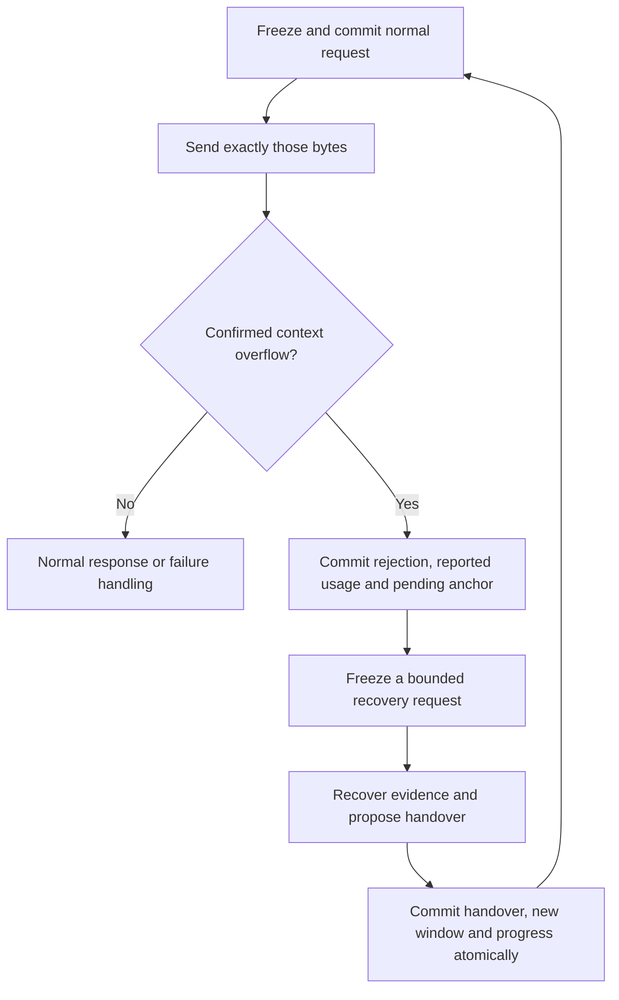

# Provider-driven context recovery research

Research date: 2026-11-08. This document separates observed implementation facts
from implications for canti. It records source inspection and offline probes,
not live provider or recovery validation.

## Finding

The proposed policy is feasible: use provider-reported usage exclusively,
send requests without predicting token count or comparing it with a model
window, and initiate automatic recovery only on a confirmed context-limit
signal. Canti already meets the no-estimation accounting principle. The
substantial change is replacing its proactive **byte-capacity** handover
policy with a durable request-rebuild path.

Two limits qualify the result. An already oversized request cannot reliably
produce its own handover merely by appending an instruction. Also, some
provider responses do not distinguish output-limit exhaustion from context
exhaustion; those cannot truthfully be called confirmed overflow. The
recommended recovery design below is a proposal, not implemented behavior.

Baseline: canti `a7e40fa244dae1d4ded178dabb559749f2659aeb`, context version 16,
core semantics 5, SQLite schema 3, host RPC protocol 5. Local source links
refer to this checkout. Bub and Republic references are pinned below.

## Bub: what the reference actually implements

The reference is Bub commit
[`7b95690550544e95588d19920864fbcb71826d59`](https://github.com/bubbuild/bub/tree/7b95690550544e95588d19920864fbcb71826d59).
Its lockfile selects Republic 0.6.0; that release tag resolves to
[`fdaddc5a42eafb6cf913dc9d2283d6fc60bf78a3`](https://github.com/bubbuild/republic/tree/fdaddc5a42eafb6cf913dc9d2283d6fc60bf78a3).
The provider-layer findings below apply to that dependency, not an unspecified
Republic release. [Bub lockfile](https://github.com/bubbuild/bub/blob/7b95690550544e95588d19920864fbcb71826d59/uv.lock#L2036-L2048)

### Observed behavior

**Automatic recovery is exception-driven and bounded.** The agent initializes
one automatic handoff allowance per run. If an exception string matches its
context-length classifier, it appends an `auto_handoff/context_overflow` anchor
with `reason` and `error`, records the failed step, and retries the run's
original prompt. A second matching exception propagates. The failed attempt
also consumes a step, so reaching `max_steps` can prevent the retry.
There is no usage-threshold comparison in this recovery branch.
[Loop and retry allowance](https://github.com/bubbuild/bub/blob/7b95690550544e95588d19920864fbcb71826d59/src/bub/core/agent.py#L505-L570),
[constant](https://github.com/bubbuild/bub/blob/7b95690550544e95588d19920864fbcb71826d59/src/bub/core/agent.py#L50)

**Classification is heuristic, not confirmed provider semantics.** Bub searches
the text of any exception with a case-insensitive regex covering phrases such
as context length/window/size, token limit, and prompt too long. It checks
neither HTTP status nor provider error code. Offline execution of the exact
function also classified `token rate limit exceeded` and
`context window metadata unavailable` as context overflow. These are concrete
false-positive examples, not observed provider incidents.
[Classifier](https://github.com/bubbuild/bub/blob/7b95690550544e95588d19920864fbcb71826d59/src/bub/core/model.py#L12-L20)

**An automatic handoff does not summarize the interrupted work.** It records
the error and moves the projection boundary; it performs no summarization
request. Default context starts strictly *after* the newest anchor. Therefore
the anchor's own state is excluded, as is earlier conversation history. The
retry normally receives the existing system prompt and original user prompt,
plus any later selected messages or customization. Bub's own documentation
explicitly says handoff neither generates a summary nor automatically injects
anchor state. Historical records remain available for retrieval.
[Documented contract](https://github.com/bubbuild/bub/blob/7b95690550544e95588d19920864fbcb71826d59/website/src/content/docs/docs/concepts/tape.mdx#L21-L31),
[query selection](https://github.com/bubbuild/bub/blob/7b95690550544e95588d19920864fbcb71826d59/src/bub/core/tape.py#L150-L163),
[exclusive boundary](https://github.com/bubbuild/bub/blob/7b95690550544e95588d19920864fbcb71826d59/src/bub/core/store.py#L180-L191),
[request construction](https://github.com/bubbuild/bub/blob/7b95690550544e95588d19920864fbcb71826d59/src/bub/core/agent.py#L582-L612)

**Explicit handoff is a separate path.** The `tape.handoff` tool accepts a
caller-written `summary` and stores it in anchor state. A model-triggered
handoff can also preserve that summary through the tool-call arguments:
the agent executes tools before appending the call/result transcript, placing
that transcript after the new anchor. This is a source-derived implication of
recording order, not automatic injection of anchor state, and it does not
apply to exception-triggered handoff.
[Tool](https://github.com/bubbuild/bub/blob/7b95690550544e95588d19920864fbcb71826d59/src/bub/builtin/tools.py#L472-L476),
[execution and recording order](https://github.com/bubbuild/bub/blob/7b95690550544e95588d19920864fbcb71826d59/src/bub/core/agent.py#L390-L432),
[transcript append](https://github.com/bubbuild/bub/blob/7b95690550544e95588d19920864fbcb71826d59/src/bub/core/tape.py#L451-L458)

**Reported usage is retrospective telemetry.** Bub copies Republic's token
usage when the stream emits `Completed`; `tape.info` finds the latest recorded
call with integer `total_tokens`, rather than estimating the next request or
returning an accumulated context measurement. Republic defines total as input
plus output, with cached input included in input. Its Anthropic normalization
adds cache-read and cache-write tokens to the provider's uncached input count.
[Bub completion handling](https://github.com/bubbuild/bub/blob/7b95690550544e95588d19920864fbcb71826d59/src/bub/core/agent.py#L773-L799),
[tape info](https://github.com/bubbuild/bub/blob/7b95690550544e95588d19920864fbcb71826d59/src/bub/core/tape.py#L332-L370),
[Republic usage definition](https://github.com/bubbuild/republic/blob/fdaddc5a42eafb6cf913dc9d2283d6fc60bf78a3/src/republic/_response.py#L46-L61),
[Anthropic normalization](https://github.com/bubbuild/republic/blob/fdaddc5a42eafb6cf913dc9d2283d6fc60bf78a3/src/republic/formats/messages.py#L408-L420)

**Missing usage is not preserved as unknown.** Republic initializes all usage
fields to zero and replaces only reported fields. Consequently a completed
response with omitted usage can become zero usage in Bub. An offline probe of
the exact `TokenUsage` class confirmed the zero defaults. Bub also keeps one
`StreamState` across steps; failure callbacks read its current usage, so a
later failure before `Completed` can expose the preceding call's usage to
hooks. That second point is a source-derived risk, not a live reproduction.
[Response builder](https://github.com/bubbuild/republic/blob/fdaddc5a42eafb6cf913dc9d2283d6fc60bf78a3/src/republic/formats/_base.py#L292-L312),
[shared state](https://github.com/bubbuild/bub/blob/7b95690550544e95588d19920864fbcb71826d59/src/bub/core/agent.py#L505-L527),
[failure callback](https://github.com/bubbuild/bub/blob/7b95690550544e95588d19920864fbcb71826d59/src/bub/core/agent.py#L662-L703)

**Successful context exhaustion has a separate gap.** Republic maps both
Anthropic `max_tokens` and `model_context_window_exceeded` to the normalized
finish reason `length`. Bub's exception handler does not inspect this finish
reason; its normal completion path reports success or continues tools.
Therefore the automatic overflow branch does not cover that provider stop
reason merely because it occurred.
[Stop-reason mapping](https://github.com/bubbuild/republic/blob/fdaddc5a42eafb6cf913dc9d2283d6fc60bf78a3/src/republic/formats/messages.py#L39-L46),
[normal completion](https://github.com/bubbuild/bub/blob/7b95690550544e95588d19920864fbcb71826d59/src/bub/core/agent.py#L419-L437)

**Bub is not globally estimation-free.** Its builtin spill sidecar defaults to
a 4,096 estimated-token threshold, implemented as four characters per token,
for replacing large tool results with a preview and retrieval handle. Its
documentation also describes an optional `bub-context-budget` plugin that
reminds the model to hand off near a limit. Neither establishes that the base
automatic recovery branch predicts request token size.
[Spill setting](https://github.com/bubbuild/bub/blob/7b95690550544e95588d19920864fbcb71826d59/src/bub/builtin/spill.py#L33-L36),
[spill comparison](https://github.com/bubbuild/bub/blob/7b95690550544e95588d19920864fbcb71826d59/src/bub/builtin/spill.py#L121-L124),
[optional budget plugin](https://github.com/bubbuild/bub/blob/7b95690550544e95588d19920864fbcb71826d59/website/src/content/docs/docs/integrations/reuse-app.mdx#L310)

### Evidence limits and implications

The inspected tests exercise reported streaming usage and tape cache ratios.
Pinned repository searches for `auto_handoff`, `context_length_exceeded`, and
`is_context_length_error` found no dedicated recovery test. This inspection
and the two Python source probes do not establish provider compatibility,
summary quality, crash recovery, or progress after repeated overflows.
[Usage fixture test](https://github.com/bubbuild/bub/blob/7b95690550544e95588d19920864fbcb71826d59/tests/test_core_agent_step.py#L256-L276),
[cache-ratio test](https://github.com/bubbuild/bub/blob/7b95690550544e95588d19920864fbcb71826d59/tests/test_tape.py#L105-L139)

There are additional retry layers: Republic defaults to two transport/status
retries, while Bub may fall back across configured models when opening a
stream. These are distinct from the single context handoff allowance.
[Republic retries](https://github.com/bubbuild/republic/blob/fdaddc5a42eafb6cf913dc9d2283d6fc60bf78a3/src/republic/providers/base.py#L76-L86),
[retryable failures](https://github.com/bubbuild/republic/blob/fdaddc5a42eafb6cf913dc9d2283d6fc60bf78a3/src/republic/providers/base.py#L276-L305),
[Bub fallback](https://github.com/bubbuild/bub/blob/7b95690550544e95588d19920864fbcb71826d59/src/bub/builtin/model.py#L137-L180)

**Inference for canti:** Bub demonstrates a small reactive boundary-reset
mechanism. It does not establish safe replacement of canti's model-written
handover with automatic summarization after overflow. A canti design still
needs explicit recovery input, trustworthy error classification, unknown
usage handling, durable request/projection transitions, and a finite
no-progress policy. Removing a proactive threshold alone cannot guarantee
that the working set after retrieval fits, or that a summary request fits
after the original request was rejected.

## Canti: current contracts and gaps

| Area | Observed behavior | Consequence |
| --- | --- | --- |
| Token accounting | `Usage` is provider-reported. Anthropic adds input, cache creation and cache read; Responses takes input and output totals. | There is no token estimator to remove. |
| Automatic handover | `requestHandover` compares rendered step bytes with `workCapacity`, plus optional `WindowSteps`/`WindowBytes`. | Setting the optional triggers to zero still triggers handover at local byte capacity. |
| Admission | `ContextFit` reserves bytes for a maximum handover, another step, retrieval evidence and repair. | This predicts local rendering capacity, not model tokens; the reserve policy needs redesign. |
| HTTP failure | Shared `StatusError` makes most 4xx responses unrecoverable, including context-limit 400s. | The run stops instead of handing over. |
| Successful truncation | Anthropic context-window exhaustion is treated as an ordinary incomplete response. | Core retries the same frozen bytes until attempts run out. |
| Handover | A model-written proposal is accepted only when requested; `Performed` commits the result, next window and progress atomically. | Reuse this commit contract, while redesigning how an overflow reaches it. |

Sources: [usage types](../runtime/internal/harness/model.go),
[Anthropic parsing](../runtime/internal/harness/anthropic/anthropic.go),
[Responses parsing](../runtime/internal/harness/openai/openai.go),
[`requestHandover` and preparation](../runtime/internal/harness/loop_context.go),
[byte reserves](../runtime/internal/harness/context_budget.go),
[status classification](../runtime/internal/harness/provider/provider.go),
[`send`](../runtime/internal/harness/loop.go),
[`handover` and `perform`](../runtime/internal/harness/perform.go).
The existing [capacity-trigger test](../runtime/internal/harness/loop_context_test.go)
(`TestZeroTriggersRequestAndAdvanceHandoverAtCapacity`) explicitly protects
the current behavior. The [Anthropic stop-reason test](../runtime/internal/harness/anthropic/anthropic_test.go)
explicitly treats `model_context_window_exceeded` as retryable.

There are two accounting gaps even without estimation. Both adapters decode
usage into integer fields, so omitted required counts become zero. Also,
`send` commits only failure text for `StopError`; its raw response and any
usage are not attached to that transition. SQLite's `delta` accounts only
`ResponseSaved` and `ResponseIncomplete`. Recovery needs a place to preserve
the actual rejection, provenance and available usage, with missing counts
represented explicitly. A request lost across a crash can have incurred
provider charges that the client never received: an honest ledger totals
**observed provider usage**, not an invented complete billing total.
Sources: [model response](../runtime/internal/harness/model.go),
[`send`](../runtime/internal/harness/loop.go),
[per-event allowed facts](../runtime/internal/harness/runner.go),
[SQLite `delta`](../runtime/internal/harness/sqlite/store.go).

## Provider signals: what can be confirmed

| Signal | Recovery classification |
| --- | --- |
| Anthropic HTTP 400, structured `invalid_request_error`, documented prompt-too-long message | Confirmed input overflow; retain status, type, message and request ID. Match only this provider envelope and a narrow documented message form. |
| Anthropic HTTP 200, `stop_reason=model_context_window_exceeded` | Confirmed context exhaustion; preserve actual usage and partial content, but accept no truncated decision. |
| OpenAI structured `error.code=context_length_exceeded` | Confirmed overflow when present. Inspect both non-2xx envelopes and failed-response envelopes supported by the concrete endpoint. |
| OpenAI `incomplete_details.reason=max_output_tokens` | Ambiguous: insufficient configured output allowance and context exhaustion can share this reason. It does not confirm overflow. |
| Generic 400, 413, 429, timeout, unknown error text, Anthropic `max_tokens` | Not sufficient evidence of context overflow. Keep distinct validation, payload-size, rate-limit, transport and output-limit handling. |

Anthropic documents both its input-overflow 400 and its separate successful
context-exhaustion stop reason. Its error reference distinguishes 413 byte
size limits from token context limits.
[Context overflow contract](https://platform.claude.com/docs/en/build-with-claude/context-windows#context-window-overflow-behavior),
[stop reasons](https://platform.claude.com/docs/en/build-with-claude/handling-stop-reasons),
[HTTP errors](https://platform.claude.com/docs/en/api/errors).

Responses documents `truncation=disabled` as the default that produces a 400
instead of dropping earlier input. Freeze that choice explicitly for the new
adapter contract. OpenAI's own Codex source classifies a failed Responses
event with `context_length_exceeded` as context exhaustion; this is useful
primary implementation evidence, not proof that every compatible endpoint
uses that code. OpenAI's reasoning guide documents the ambiguous
`max_output_tokens` result for either generation limit.
[Responses truncation](https://developers.openai.com/api/reference/resources/responses/methods/create),
[official SDK definition](https://github.com/openai/openai-python/blob/main/src/openai/types/responses/response_create_params.py),
[pinned Codex classifier](https://github.com/openai/codex/blob/748ab55ca7de0b647d9a7a9d9a8e70e00f28666d/codex-rs/codex-api/src/sse/responses_error.rs#L46-L48),
[reasoning limits](https://developers.openai.com/api/docs/guides/reasoning#allocating-space-for-reasoning).

Consequently, the strict policy can guarantee "only confirmed signals open
automatic overflow recovery". It cannot guarantee "every context exhaustion
is identifiable and automatically recoverable" across all APIs. Ambiguous
incomplete responses need a finite separate policy and an explicit failure
if they remain unresolved. Increasing output allowance may be a separately
configured response to output truncation; it is not evidence of overflow.

## Proposed target policy

### Accounting and resource bounds

1. Keep per-attempt usage and its presence/validity. Sum only provider-reported
   counts, once per durable response. Preserve raw usage and API provenance;
   distinguish missing required counts from optional fields whose omission
   the API defines as zero. Do not replace missing counts with estimates.
2. Keep `max_tokens` / `max_output_tokens` as provider generation controls and
   the run token budget as a retrospective usage budget. Neither estimates
   the next request. Recovery calls consume the same usage and wall-time
   budgets. A hard prepaid total cannot be guaranteed from retrospective,
   occasionally missing usage alone.
   Recommended missing-usage policy: when a finite token budget is configured,
   stop before another call if required usage is unavailable or invalid,
   recording an accounting-unavailable cause rather than falsely claiming
   budget exhaustion. With no token budget, continuation may use the existing
   finite time/attempt bounds while keeping usage visibly incomplete. This
   policy still cannot retroactively bound the cost of an unreported call.
3. Remove proactive `WindowSteps`, `WindowBytes`, and `used >= workCapacity`
   handover triggers from this policy. Remove token-count preflight, tokenizer,
   characters-per-token conversions, and model-window tables if introduced
   elsewhere during implementation. Current production Go sources contain
   no estimator/tokenizer matches.
4. Retain explicit byte limits for memory, request transport, output previews,
   archive reads and handover text. Rework `PromptLimits.Total`, `ContextFit`,
   session selection and carry admission so the old 128/256 KiB total prompt
   caps and separately computed reserves
   do not silently preserve the old early-handover policy. A local hard-limit
   failure is a resource error; it must not be reported as provider overflow.
   Fixed safety caps can still be reached first on a large-context model.

The token ledger and context policy should remain separate modules of
behavior: the next request's fit never follows from the last request's usage.
Session dialogue currently calls `ValidateContext` during selection, and
handover carry checks the same local capacity, so changing only the trigger
would leave related old policy in place.
Sources: [session selection](../runtime/internal/harness/session_context.go),
[handover admission](../runtime/internal/harness/perform.go),
[prompt limits](../runtime/internal/harness/prompt.go),
[host admission](../runtime/internal/host/config.go).

### Durable anchor and handover

Treat an anchor as a committed boundary and recovery provenance, distinct
from a model-written summary. The recommended flow is:

**Commit point 1:** atomically record the rejected request's identity
`(run, step, attempt, revision)`, sanitized provider signal, raw response when
available, usage availability, old window boundary, archive references and
pending recovery state. The pending anchor marks where recovery started; it
does not claim a successful summary or erase old records. Restart after this
commit reconstructs recovery instead of resending known-rejected bytes.
If the process dies before this fact commits, the provider result is unknown
and the existing lost-attempt contract still applies.

**Recovery request:** retain the full authoritative goal and constraints,
the required protocol and environment restrictions, committed progress and
the latest execution result or its precise reference. Add the previous
handover when usable and a bounded archive manifest of the interrupted
window. Clearly label selected and omitted evidence. This is a deliberately
different projection, with its own frozen bytes and provenance, rather than
the rejected full prompt plus another instruction.

Optional historical blocks may be reduced deterministically, by whole
records and byte-bounded pages, after a further confirmed overflow. This is
reactive input reduction, not token prediction. Record each selection and
revision. If the irreducible authoritative input itself overflows, stop with
that explicit cause; never silently shorten the user's goal or constraints.
Large-history summarization can use bounded retrieval and multiple requests,
but every call and every omitted range must remain visible in the journal.

Allow recovery to use bounded read-only retrieval before proposing the
handover, under a finite recovery budget. The current gate refuses retrieval
whenever `Window.Requested` is true and counts unsuccessful handovers; it
must distinguish evidence recovery from a rejected handover proposal. Bind
the allowed action and recovery contract at acceptance as today. External
effects cannot run while the recovery projection is incomplete. If the model
returns a blocker, ordinary return semantics still apply: return is not
proof of successful handover.
[Current action gate](../runtime/internal/harness/action.go),
[window validation](../runtime/internal/harness/window.go),
[context reconstruction](../runtime/internal/harness/loop_context.go).

**Commit point 2:** reuse the local handover action's atomic `Performed`
contract to persist accepted summary, explicitly selected carry references,
new window and step progress; clear pending recovery in that same commit.
Extract shared window-opening validation instead of synthesizing a model
decision or an artificial completed tool step. Automatic anchor provenance
must be distinct from `SourceStep`, which currently means the actual step
that proposed a handover. Frozen old requests remain immutable.

Bound repeated overflow by durable per-recovery attempts and reductions, and
bound repeated recovery without useful work. Resume must not reset either
bound. Successful handover alone is not useful progress. A larger effective
window may reduce premature handovers, but cannot prove elimination of
retrieval-driven thrashing or make an oversized necessary working set fit.

### Core and version implications

Existing `ResponseIncomplete` returns to `PhaseRequestFrozen`, reusing the
same bytes; only protocol decoding failure currently returns to preparation.
Introduce a generic recovery semantic such as `RequestRejected` meaning
"this attempt ended; rebuilding input is required", carrying step/attempt
identity and consuming a bounded attempt. Core decides the next phase and
attempt budget; the harness attaches overflow/anchor facts and chooses the
new projection. Final naming and whether this is a new event or an explicit
retry disposition belong in the implementation specification. It must not
be a core capability named `Handover` or a fake protocol-decode failure.
In particular, current `prepare` handles every `RequestRev > 0` by loading
and decoding the preceding response as protocol-repair evidence. A rebuild
disposition must select preparation from pending-recovery facts instead;
the overflow envelope is not a malformed agent decision.
[Transition rules](../runtime/core/state.go),
[events](../runtime/core/event.go),
[fact validation](../runtime/internal/harness/runner.go),
[current revision preparation](../runtime/internal/harness/loop_context.go).

| Boundary | Expected changes |
| --- | --- |
| `core/` | Rebuild-versus-resend semantics and transition/replay tests; next semantics version. |
| `harness/{model,loop,loop_context,perform,window,context_budget,session_context,runner,store}.go` | Typed overflow, usage availability, recovery facts, request construction, action gate and atomic handover completion. |
| `harness/{anthropic,openai,provider}` | Provider-specific classification, raw result/provenance retention and explicit truncation policy. |
| `harness/sqlite` | Allowed facts, recovery reads, delta accounting, idempotent commits and reopen/crash evidence; schema version if persisted layout changes. |
| `host`, CLI, SDK and TUI | Revised configuration/admission, visible recovery and usage-unknown projection; RPC version and append-only samples if wire messages change. |
| Existing documentation | Update architecture, development flags and acceptance evidence that describe the old reserve policy. |

Request rendering, reserves and selection change, so advance context version
from 16 to the next available version and add new frozen fixtures. The new
transition behavior advances semantics from 5 to the next available version.
Do not rewrite historical fixtures. Follow the project's existing unsupported
state policy rather than silently interpreting old journals under new rules.

## Required implementation evidence

- Provider fixtures: confirmed overflow, Anthropic HTTP-200 context stop,
  ambiguous Responses output limit, unrelated 400/413/429, malformed and
  missing usage, caching normalization, and partial content that resembles a
  valid command but must never execute.
- Core and SQLite: rejection-to-rebuild transitions, attempt exhaustion,
  duplicate commit acknowledgement, restart before/after both commit points,
  stop/cancel races and no replay of an already accepted external effect.
- Recovery: one huge result, oversized first goal, oversized summary/carry,
  missing archive evidence, a second overflow during recovery, and a repeated
  handover/read/refill cycle with no useful progress.
- Long-run comparison: same task/model/provider, reported usage and latency,
  handovers per useful step, retrieval bytes reread, task completion, and
  incomplete usage coverage. More successful handovers alone is not success.
- Concrete provider validation: record sanitized envelopes and run config for
  both APIs and each claimed compatible endpoint. Offline fixtures cannot
  establish how an endpoint signals actual overflow. Implementation would
  also require `make integration` because adapters/storage/CLI change.

## Verification of this research

Only this research document changes. Bub source probes are described above.
Canti checks run from the isolated research worktree:

| Command | Observed result |
| --- | --- |
| `make check lint` | Passed; all three modules checked, lint reported zero issues with and without integration/live build tags. |
| `go test -count=1 -race ./runtime/... ./sdk/go/... ./apps/tui/...` | Passed; runtime CLI 370.642s, harness 197.748s, SQLite 83.369s, remaining tested packages passed. |
| `git diff --cached --check` | Passed for the staged research document. |

These checks establish the inspected baseline, not the proposed behavior.
No live model request or Docker integration experiment was performed for this
research, and the proposed recovery path remains unimplemented.

## Prior-context retrieval

Nowledge MCP `memory_search`, query `canti bub context window handover token
estimation`, mode `normal`, configured strict scope `default`, limit 5, no
extra filters, returned five records. The relevant record read in full was
(server `relevance_score`):

| Rank | Memory ID | Title | Score |
| --- | --- | --- | --- |
| 1 | `b3071ff5-40c1-43b5-8100-22204721b7aa` | Canti handoff failure was retrieval-driven context thrashing; Bub superiority remains unproven | 0.99 |

Only record 1 was read in full, to preserve the earlier distinction between
handover mechanics and retrieval-driven thrashing. Implementation conclusions
above were checked against current primary sources. Graph rendering was
skipped because matching Space enforcement could not be confirmed.
